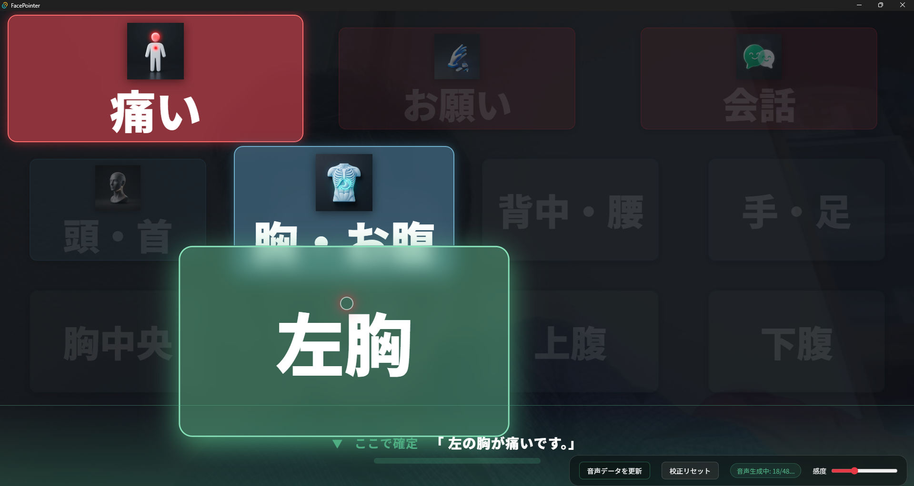

# FacePointer

FacePointerは、顔の動きだけで操作できるコミュニケーションボード（意思伝達装置）です。
発話や肢体に不自由がある方、失語症などの症状がある方が、視線やまばたき（または特定の顔のジェスチャー）で自分の意思を周囲に伝えることを目的としています。

 <!-- アイコンなどがあればここに配置 -->

## 🌟 主な機能

- **顔トラッキング:** MediaPipe FaceLandmarkerを使用した、高精度かつ低遅延な顔認識。
- **ポインタ操作:** 鼻の向きでマウスカーソル（赤いポインタ）を操作し、ボタンを選択。
- **症状モード:** 初期画面で「かゆい / 痛い」の2択を大きなボタンで表示し、口を開く操作で確定。続けて「頭 / 体 / 手 / 足」を選ぶと「頭が痛いです」のように即時発話できます。
- **3段階の階層メニュー:** 「したい事」→「具体的な動作」→「最終決定」の流れで、直感的に文章を構築。
- **確定ゾーン方式:** 画面下部の特定のエリアにポインタを置く（滞留させる）ことで決定。誤操作を防止。
- **シンプルモード:** パネルを選ぶだけで発話。しばらく止まると円グラフ状のインジケータが埋まって確定（滞留選択）。
- **口ジェスチャー確定:** 症状モードでは、口を開くことでホバー中のボタンを確定します。
- **最高品質の音声合成:** Google Gemini 2.5 Flash TTS (`Achernar`) に対応。非常に自然で落ち着いた日本語音声で発話をサポート。
- **音声キャッシュ (IndexedDB):** 生成した音声は保存され、2回目以降は瞬時に再生されます。
- **デスクトップアプリ化:** Tauri (Rust) を使用した軽量なWindowsデスクトップアプリとして動作。

## 🚀 インストール & 実行

### 一般ユーザー (実行・インストール)
1. [Releases](https://github.com/ohru131/FacePointer/releases) から最新の `FacePointer_x.x.x_x64_en-US.msi` をダウンロードしてインストールします。
2. または、`FacePointer.exe` を直接実行してください。
3. インストールせずに試す場合は、ブラウザ版 https://ohru131.github.io/FacePointer/ を開きます（カメラの許可が必要）。

### ブラウザ版（GitHub Pages）
- `main` へのpushで `.github/workflows/pages.yml` が `dist/` とMediaPipeモデルをGitHub Pagesへ自動デプロイします（Windowsビルドとは別ジョブで並行実行）。
- 初回のみ、リポジトリの Settings → Pages → Build and deployment の Source を「GitHub Actions」にしてください。
- 設定・学習内容・APIキーはブラウザごとに保存されます（デスクトップ版とは共有しません）。

### 開発者 (ビルド方法)

このプロジェクトを自分でビルドするには、以下の環境が必要です：
- [Node.js](https://nodejs.org/) (v16以上)
- [Rust](https://rust-lang.org/) (Tauriのビルドに必要)

```bash
# 依存関係のインストール
npm install

# 開発用モデルのダウンロード
./download_models.ps1

# 開発モードで実行
npm run tauri dev

# リリースビルド (インストーラーの作成)
npm run tauri build
```

## 🎙 音声合成 (Google Gemini TTS) について
本アプリは **Google Gemini 2.5 Flash TTS** を使用して発話を行います。
初期設定として、画面右上の **⚙（介助者メニュー）→「設定」→「音声」タブ** で「Gemini API Key」を入力し、保存してください。

### TTSモデルの選択
提供モデルは順次入れ替わるため、設定画面の **「モデル一覧を取得」** で利用可能なモデルを取得して選べます。
- `Cloud TTS: ja-JP-...` : Google Cloud Text-to-Speech の日本語音声 (既定: `ja-JP-Neural2-B`)
- `Gemini: ...-tts` : Gemini API の TTS モデル。「Gemini 話者」で声 (既定: Zephyr)、「Gemini 口調指示」で話し方 (既定: 明るく、はきはきした女性の声) を変更可

取得した一覧はブラウザに保存されます。モデル変更後は「音声データを更新」で音声を再生成してください。

### オフラインでの利用（重要）
1. インターネットに接続された環境で、画面右上の ⚙（介助者メニュー）にある **「音声データを更新」** をクリックします。
2. アプリが階層メニューと症状モードの全文章の音声を生成し、ブラウザのキャッシュ (IndexedDB) に保存します。
3. 一度保存が完了すれば、**オフライン（病院内などネットがない場所）でも** 生成済みの高品質な音声でそのまま使い続けることができます。

※ APIキーが設定されていない、または通信エラーが発生した場合は、OS標準の日本語音声（Microsoft Nanami等）が自動的に選択されます。

## 📁 階層データのカスタマイズ
`hierarchy.txt` を編集することで、表示されるボタンの名前や階層構造を自由に変更できます。

- 開発モード (`npm run tauri dev`) では、`dist/hierarchy.txt` が初期データとして使われます。
- インストーラー版では、設定画面から保存した内容はユーザーごとの AppData 配下にある `hierarchy.txt` に保存され、次回起動時からそちらが優先されます。
- `dist/hierarchy.txt` を変更した場合は、反映のため再ビルド・再インストールが必要です。

```text
食事|media/food.png
  ごはん
    ごはんを食べたい
  パン
    パンが食べたい
```

## 🛠 技術スタック
- **Frontend:** HTML, JavaScript, CSS (Vanilla)
- **AI/ML:** [MediaPipe Vision](https://developers.google.com/mediapipe/solutions/vision/face_landmarker)
- **Backend/Desktop:** [Tauri](https://tauri.app/) (Rust)
- **Audio:** Web Audio API & Google Gemini TTS (Generative AI)

## 🎮 操作モード
- **症状モード (デフォルト):** 「かゆい / 痛い」から始めて、続けて体の部位を選ぶ2段階モードです。30秒操作がない場合は初期画面に戻ります。
- **シンプルモード:** フレーズをパネルで一覧表示し、パネルを選ぶだけで即発話します。ポインタは縦横自由に動かせます。
  - **グリッドサイズ:** 2×2 / 3×2 / 3×3 / 4×3 / 4×4（既定）。入りきらない分は下部の「◀ 前へ / 次へ ▶」でページ送り（端で反対側へ回り込み）。
  - **休憩パネル:** 選ぶと休憩中になり、「再開」以外は滞留でも口でも確定しません。再開は通常の2倍（最低2秒）の滞留が必要です。
  - **確定音:** 確定時に短い「ピポッ」を鳴らします（設定でOFF可）。
  - **滞留(dwell)確定:** パネル上でポインタを止めると円グラフ状のインジケータが埋まり、満タンで確定・発話します。動くとやり直し。時間は設定画面で 0.8〜3.0秒 / OFF（口を開けて確定のみ）から選択（既定 1.5秒）。
  - **再選択防止:** 確定したパネルは、一度別のパネルへ移るまで再確定しません（起動・モード切替直後に乗っているパネルも同様）。
  - 口を開ける確定も併用できます。
- 設定画面の「操作モード」で切り替えできます。

- **パネルごとの滞留時間:** 設定のパネル一覧の右端で 0.8〜5.0秒を個別指定（例: 「はい」は短く、緊急系は長く）。

- **お話モード:** 事前に用意した会話（`dist/talk-data.js`、約310項目）を「話題 → 内容 → …」と2〜4回選んで話す。
  - 話題: 👋あいさつ / 💗気持ち / ❓聞きたい / 📚マンガ・アニメ（刀剣乱舞・ジブリなど） / 📷思い出・家族 / 🙏お願い・相談
  - どの段でも先頭の「🔊 これで話す」で確定。続きのない言葉（赤）を選ぶとそのまま話す。続きのある言葉は青。「◀ 戻る」「🏠 最初から」で戻る。
  - **👤 相手:** 来ている人（お父さん・お母さん・お姉ちゃん・お兄ちゃん・看護師さん）を選ぶと、文頭に「お母さん、〜」と呼びかけが入り、その人向けの話題も出る。決めなければ呼びかけなし。
  - **😄 相づち:** 「へえ！」「それで？」「わかる！」「あはは」など16種を1回で話す（相手の話に反応する用）。
  - **⭐ よく話す:** 話した文を回数順に出し、選ぶとそのまま話す（この端末内だけに保存、設定で消去可）。
  - あいさつは時間帯（朝・昼・夜）に合うものだけ出る。
  - 設定 →「お話」タブで、話題・言葉ごとの表示/非表示（外すとその先も出ない）、文の追加（「✏️ 自分の言葉」に並ぶ。先頭に `{呼}、` で呼び名が入る）。
  - 会話データは `dist/talk-data.js` の `TALK_TREE`（id / label / emoji / say / children 最大5 / for / time）。旧「文づくりモード」はお話モードに置き換えた。
- **設定中は停止:** 設定画面を開いている間は、滞留・口開けの確定、段階移動、自動復帰を止め、ポインタも隠す。

### 質問への返事テンプレート（介助者メニュー → 質問する）
- 介助者が質問を選ぶと、画面が回答パネルだけに切り替わり（症状モード中でも可）、上部に質問文を表示・読み上げ。
- 回答すると発話して元の画面へ戻る。「✕ やめる」、介助者メニューの「質問を終了して戻る」、90秒放置でも戻る。
- プリセット: はい・いいえ／どこが痛い？／痛さは？／どこがかゆい？／気分は？／暑い？寒い？／体の向きは？／何がしたい？／誰に会いたい？
- 設定 →「質問」タブで、メニューに出す質問の選択、質問の読み上げON/OFF、任意の質問の追加（答えは1行1つ「絵文字 表示名=発話文」）。

### シンプルモードのパネル設定（設定 → シンプルモード タブ）
- **画面の配置（ドラッグ）:** 実画面と同じ縦横比・グリッドのプレビューをページごとに表示。タイルをドラッグで並べ替え、右の「追加できるパネル」からドラッグ（またはクリック）で追加、✕ か右の一覧へドラッグで外す。タイルをクリックすると滞留時間・前後移動・削除を設定。症状モードの16フレーズに加え、追加プリセット48種（画像または絵文字付き）から選べます。プリセットは「40代女性・未婚、両親と姉・兄が1人ずつ、入院/療養中」を想定し、返事／家族（お母さん・お父さん・お姉ちゃん・お兄ちゃん等）／体調（生理かも・口が乾く等）／ケア・身だしなみ（女性の方に・髪をとかして等）／過ごし方／気持ち／あいさつに分類しています（`dist/app.js` の `SIMPLE_EXTRA_PRESETS`）。
- **任意パネルの追加:** 表示名・発話文・絵文字・画像（任意）を指定して追加。画像は256pxに縮小してブラウザ（localStorage）に保存されます。任意パネルは一覧の「削除」で消せます。
- 保存は「保存して閉じる」で確定。

## 🧰 画面構成
- **利用者の画面:** パネルのみを大きく表示。右上の小さな ⚙ 以外の操作部品は出しません。
- **介助者メニュー（右上の ⚙）:** 設定・キャリブレーション・校正リセット・音声データ更新、表示切替、感度スライダー、計測値。閉じると ⚙ だけに戻ります。
- **設定画面:** 左の分類（操作 / シンプルモード / 音声）で切り替え。「保存して閉じる」で反映、「キャンセル」「✕」で破棄。

## 📄 ライセンス
MIT License

---
Developed by [ohru131](https://github.com/ohru131)
